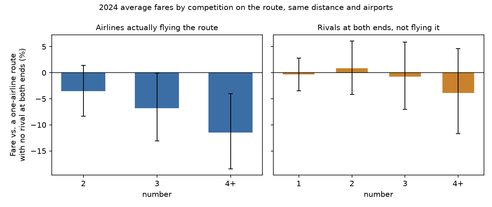
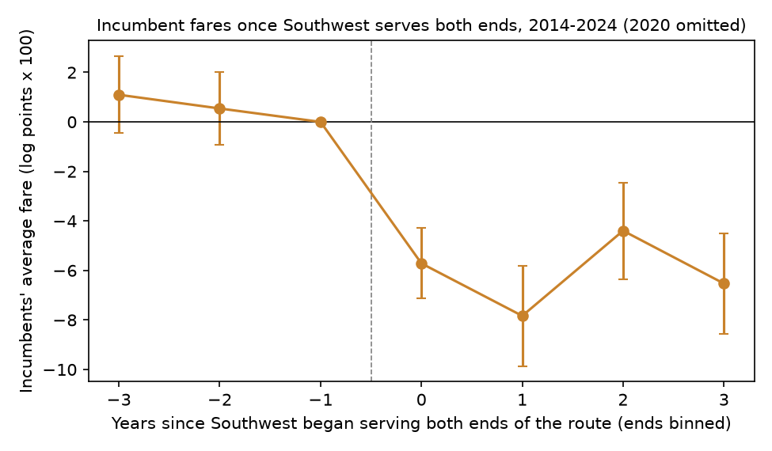

# The Airline Waiting at the Gate

### In 1982 William Baumol argued that the threat of entry alone could hold a monopoly's prices to cost, and he pointed to the airlines. I asked his question again with eleven years of US airline tickets.

---

A one-way ticket between Washington National and Dallas/Fort Worth cost $304 on average in 2024. American Airlines
sold 97% of the tickets on that route. It was not for lack of other airlines nearby. Delta, United, Alaska, JetBlue
and Frontier all ran regular nonstop service out of both airports, and in the language of the theory each of them
was a potential entrant. Across the country, on routes of similar length where three or more airlines actually
flew, the average fare was $227.

Washington to Dallas is one of thousands of city pairs in the Transportation Department's ticket sample, and it is
a clean example of the question William Baumol put to economists in 1982. If an airline can fly into a market
whenever it likes and leave again without losing much, then the airlines sitting at both ends of a route should
keep fares down as well as an airline already on it. Counted that way, American faced five rivals on the route, and its fares should have looked
like it. The fares on that route, and on thousands like it, do not behave that way.

---

## Two ways to count competitors

Economists usually measure how concentrated a market is with the Herfindahl-Hirschman Index, the sum of each
seller's squared market share. With shares measured in percent,

```math
\text{HHI}_m = \sum_{j=1}^{J_m} s_{jm}^2, \qquad s_{jm} = 100 \times \frac{\text{passengers}_{jm}}{\text{passengers}_m}
```

where $`s_{jm}`$ is airline $`j`$'s share of the passengers on route $`m`$ and $`J_m`$ is the number of airlines
selling tickets on it. Boston Logan to Washington National in 2024 had three airlines selling nearly all the tickets, with JetBlue
at 45.0% of passengers, American at 29.0% and Delta at 25.7%, so

```math
\text{HHI}_{\text{BOS-DCA}} = 45.0^2 + 29.0^2 + 25.7^2 \approx 3{,}526
```

| Route structure | Calculation | HHI |
|---|---|---|
| One airline with every passenger | 100² | 10,000 |
| Two airlines splitting it evenly | 2 × 50² | 5,000 |
| Four airlines splitting it evenly | 4 × 25² | 2,500 |

Baumol's theory asks for a second count. An **actual competitor** on a route, in this study, is an airline that
sells at least 5% of the route's tickets. A **potential entrant** is an airline with regular nonstop service at both
endpoint airports (at least 1,000 sampled nonstop passengers a year at each, roughly a daily round trip or more)
that is not an actual competitor on the route. On Boston to National in 2024 the count was three actual competitors
and four potential entrants. Contestability theory says the second number should do the work of the first.

---

## William Baumol and the uprising

William Baumol was born in the South Bronx in 1922 and spent most of his career at Princeton and New York
University. He was president of the American Economic Association in 1981, and his presidential address, published
in the *American Economic Review* in March 1982 as "Contestable Markets: An Uprising in the Theory of Industry
Structure," announced a theory he had built with John Panzar and Robert Willig and set out at full length in their
book of the same year. He died in 2017 at 95.

I could not read the 1982 address itself, which sits behind a paywall. Two years later Baumol restated the theory,
with its airline application, in an article written with Elizabeth Bailey, who had served on the Civil Aeronautics
Board from 1977 to 1983. That article, in the first volume of the *Yale Journal on Regulation*, is the source for
what follows. A market is perfectly contestable, they wrote, if no price can survive when an
entrant could undercut it and still earn a profit, or equivalently if firms can enter and later leave without
losing any of their investment (p. 113). In such a market a monopoly or a tight oligopoly cannot earn excess profits
or run inefficiently (p. 116), and if efficient operation leaves room for two or more firms, price must equal
marginal cost (p. 117). Let $`C(y)`$ be the cost of serving $`y`$ passengers,
differentiable and the same for incumbents and entrants, $`Q(p)`$ the number of passengers who would fly at fare $`p`$, and $`y_i`$
the passengers carried by incumbent $`i`$, with at least two incumbents each carrying some passengers. Sustainability means no entrant charging $`p`$ or less can profit by
serving any quantity the market would buy, and free entry pushes each incumbent's profit to zero:

```math
\begin{aligned}
\pi(y) &\equiv p\,y - C(y) \le 0 \quad \text{for all } 0 \le y \le Q(p) \\
\pi(y_i) &= 0 \quad \text{for each incumbent } i \\
n \ge 2 &\;\Rightarrow\; 0 < y_i < Q(p) \\
&\;\Rightarrow\; y_i \text{ is an interior maximum of } \pi \text{ on } [0, Q(p)] \\
&\;\Rightarrow\; \pi'(y_i) = p - C'(y_i) = 0 \;\Rightarrow\; p = MC
\end{aligned}
```

The incumbents' own output already earns the most that any output could earn at that price, so a fare above
marginal cost would hand an entrant a profitable slice of the market, and the fare is pinned to cost whether two
airlines fly the route or six.

Airlines were the showcase. The main capital in the business, the airplane, could be moved from one market to
another, and Bailey and Baumol quoted Alfred Kahn's description of aircraft as "marginal costs with wings" (p. 128).
The Airline Deregulation Act of 1978 had removed the Board's power to block entry, and the theory gave a reason to
expect that even routes served by a single carrier would be priced as if they were competitive. For merger review, the Board saw no competitive problem
as long as comparable airlines had stations at one or both ends of the overlapping routes (p. 132).

The objections arrived quickly. Marius Schwartz and Robert Reynolds, economists at the Justice Department, argued in
the *AER* in 1983 that even a moderate lag before entry lets incumbents charge monopoly prices until the entrant
arrives, so that small departures from the ideal produce large departures from contestable behavior (as summarized by
Bailey and Baumol, p. 122). Bailey and Baumol themselves conceded that the theory's assumption of "sticky" incumbent prices did not hold in aviation, where incumbents often
matched a newcomer's fares at once, and that although potential competition from trunk carriers had policed some fares in
the first years after deregulation, actual competition had played a significant role in virtually all markets since
(p. 129). They reported the Board staff's finding that fares were higher at the four airports short of landing
slots and where concentration was pronounced (p. 130), and they flagged sunk costs at airports, in landing slots and in long-term leases of airport space (p. 131). The idea survived
as a direction of attention, toward entry barriers rather than head counts. The strong claim, that head counts do
not matter once entry is free, is the one I test here.

---

## How I tested it

The Bureau of Transportation Statistics publishes a 10% random sample of every domestic airline ticket, the DB1B
Origin and Destination Survey, every quarter. I used all 44 quarters from 2014 through 2024, about 499 million
sampled passenger trips after the usual filters (fares between $25 and $2,500, no bulk fares, no tickets sold by two
different airlines, at most two connections in each direction). A market is a pair of airports in either direction,
in a year. I kept pairs with at least 730 sampled passengers a year, about 20 actual passengers a day, and at least
100 miles apart, which left 5,810 markets in 2019 and 6,186 in 2024. The fare is the average one-way fare per
passenger across every airline and every routing on the pair.

The theory's sharpest prediction is that, once cost is held fixed, fares do not depend on how many airlines fly the
route or how concentrated it is. I treat the cost of a trip as a matter of its distance and its two airports (fees,
congestion, the local mix of business and leisure travelers), so I compared routes of the same length between the
same airports. The estimating equations for route $`m`$ with endpoint airports $`a(m)`$ and $`b(m)`$ are

```math
\begin{aligned}
\ln F_m &= \beta \ln \text{HHI}_m + \gamma N^{\text{pot}}_m + \delta_1 \ln D_m \\
&\quad + \delta_2 (\ln D_m)^2 + \mu_{a(m)} + \mu_{b(m)} + \varepsilon_m
\end{aligned}
```

```math
\begin{aligned}
\ln F_m &= \theta_A N^{\text{act}}_m + \theta_P N^{\text{pot}}_m + \delta_1 \ln D_m \\
&\quad + \delta_2 (\ln D_m)^2 + \mu_{a(m)} + \mu_{b(m)} + \varepsilon_m
\end{aligned}
```

where $`F_m`$ is the average fare, $`D_m`$ the nonstop distance, $`N^{\text{act}}_m`$ and $`N^{\text{pot}}_m`$ the
counts of actual competitors and potential entrants, and $`\mu`$ one fixed effect for every airport, switched on at
either end. Perfect contestability says $`\beta = 0`$ and $`\theta_A = 0`$. The weaker version, that a potential
entrant is worth as much as an actual one, says $`\theta_A = \theta_P`$. Standard errors are clustered by airport in
the dyadic sense, so any two routes that share an endpoint airport, at either end, may have correlated errors. I ran each equation
separately for 2019, the last normal year before the pandemic, and 2024, and for every other year as a check.

Concentration and fares are decided together, since a route that can bear high fares may attract or repel airlines
for that reason. As a check I instrumented the route's HHI with a predicted HHI built only from each airline's share
of nonstop traffic at the two endpoint airports, which reflects each carrier's network rather than the route
itself. Airline codes are taken as they appear on tickets, so US Airways and Virgin America count as separate
airlines until their tickets disappear into American's and Alaska's.

---

## The airlines flying a route set its price

The plain averages hide the pattern, because one-airline routes are short and short trips cost more per mile.

| Airlines with 5%+ of passengers, 2024 | Routes | Share of passengers | Average fare | Average distance | Potential entrants per route |
|---|---|---|---|---|---|
| 1 | 1,071 | 12% | $202 | 756 miles | 2.2 |
| 2 | 1,351 | 25% | $232 | 1,013 miles | 2.8 |
| 3 | 1,845 | 31% | $237 | 1,298 miles | 2.3 |
| 4 or more | 1,919 | 32% | $240 | 1,582 miles | 2.3 |

Holding distance and both airports fixed, each additional airline actually flying a route lowered the average fare
by about 4.7% in 2024, almost exactly what it did in 2019. A route with four or more airlines was 11.5% cheaper than
a one-airline route between comparable airports with no rival waiting at both ends, and three airlines took 6.8% off.
On the $202 average one-airline fare, 11.5% is about $23 each way.



Among the fifteen busiest routes in 2024 where one airline carried at least 90% of passengers and at least two
rivals waited at both ends, the table shows the three with the highest and the three with the lowest fares relative
to routes of similar length where three or more airlines fly (all fifteen are in `results/FINDINGS.md`). The
comparison does not adjust for the airports.

| Route, 2024 | Airline | Its share | Rivals at both ends | Miles | Average fare | Fare on 3+ airline routes of similar length |
|---|---|---|---|---|---|---|
| Washington National to Dallas/Fort Worth | American | 97% | 5 | 1,192 | $304 | $227 |
| Sacramento to Orange County | Southwest | 98% | 6 | 404 | $217 | $163 |
| San Jose to Orange County | Southwest | 100% | 6 | 342 | $216 | $163 |
| Dallas Love Field to Denver | Southwest | 100% | 2 | 651 | $165 | $196 |
| LaGuardia to Chicago Midway | Southwest | 100% | 2 | 725 | $154 | $196 |
| Long Beach to Las Vegas | Southwest | 100% | 2 | 231 | $122 | $163 |

The three with premiums above 30% all touch an airport where getting in is hard. National was already one of four
slot-controlled airports when Bailey and Baumol wrote (p. 130), and they singled out Orange County's John Wayne
Airport for a plan to keep new airlines out (p. 131). The cheapest are Southwest routes out of Long Beach, Chicago Midway and Dallas Love Field, and a one-airline
route is only as expensive as that airline's cost structure and strategy make it.

---

## Rivals waiting at both ends barely move fares

The second number, the airlines that could enter, is where the theory lives, and its effect is small. In 2024 each
additional potential entrant lowered fares by 1.6%, with a confidence interval running from a 3.5% cut to a 0.4%
increase. Once the share of passengers flying nonstop is held fixed, the effect falls to zero in both years. The
formal results for 2024 are

```math
\begin{aligned}
\hat{\theta}_A &= -0.048\ (0.013), \qquad \hat{\theta}_P = -0.016\ (0.010), \qquad N = 6{,}186 \\
\hat{\theta}_A - \hat{\theta}_P &= -0.032\ (0.006), \qquad p < 0.001
\end{aligned}
```

and for 2019 the gap is −0.029 (0.006), also with p < 0.001. An actual competitor was worth about three potential
ones. The gap is significant at the 5% level in 2018 through 2021, 2023 and 2024. It is not in 2014 through 2017,
when potential entrants mattered nearly as much as actual ones (−0.021 against −0.027 log points in 2014), or in
2022 (p = 0.06 in both 2017 and 2022). The weaker form of contestability fit the market a decade ago better than it
fits it now.

The concentration test is less decisive than the head count. With the HHI in the equation,

```math
\begin{aligned}
\hat{\beta}_{2024} &= 0.045\ (0.035),\quad 95\%\ \text{CI}\ [-0.025,\ 0.114] \\
\hat{\beta}_{2019} &= 0.071\ (0.028),\quad p = 0.011
\end{aligned}
```

so in 2024 I cannot reject the contestability prediction of zero by this measure alone. The implied fare gap
between a monopoly and two equal airlines is 3.1% in 2024 and 5.0% in 2019. Instrumenting the HHI with the
endpoint-presence prediction makes the effect larger, $`\hat{\beta} = 0.146\ (0.077)`$ in 2024, or a 10.6% gap
between a monopoly and an even duopoly, but less precise, with p = 0.06. Across all eleven years the OLS coefficient
is positive every year and significant at 5% only in 2019 and 2020, so the head count of actual airlines carries
the rejection more firmly than the index does.

---

## Southwest's arrival is the exception

In 2008 Austan Goolsbee and Chad Syverson used Southwest's expanding network to find routes where the odds of entry jumped, the
moment Southwest began flying from the second of the two airports, and they found that incumbents cut fares
significantly when threatened, with more than half of Southwest's total effect on their fares arriving before it
started flying the route. I reran their test on 2014 to 2024.

In the ticket data Southwest arrives at Long Beach in 2016, Cincinnati in 2017, four Hawaiian
airports in 2019, Miami in 2020, and in 2021 at Chicago O'Hare, Houston Bush, Sarasota, Savannah, Colorado Springs and
nine others. A route is "threatened" in the first year Southwest has regular service at both ends without flying the route itself. I
followed 507 such routes, 227 of which Southwest later entered, against 2,982 routes Southwest never touched. The
equation compares each route with itself over time, net of the national swing in fares,

```math
\begin{aligned}
\ln F^{\text{inc}}_{rt} &= \sum_{k \ne -1} \tau_k \,\mathbf{1}[t - T_r = k] \\
&\quad + \lambda W_{rt} + \alpha_r + \phi_t + u_{rt}
\end{aligned}
```

where $`F^{\text{inc}}_{rt}`$ is the incumbents' average fare in 2024 dollars on route $`r`$ in year $`t`$,
$`T_r`$ the year the threat began, $`W_{rt}`$ a switch for years in which Southwest actually flies the route,
$`\alpha_r`$ and $`\phi_t`$ route and year effects, and errors clustered by route. I left out 2020, when the number of
sampled passengers fell 61% from 2019. The result is

```math
\begin{aligned}
\tfrac{1}{4}\textstyle\sum_{k=0}^{3} \hat{\tau}_k &= -0.061\ (0.008) \\
\hat{\lambda} &= 0.007\ (0.012), \qquad N = 24{,}153 \text{ route-years}
\end{aligned}
```

Incumbents' fares fell about 6% in the first four years after Southwest landed at both ends, and the data cannot
detect any further cut once Southwest actually began flying. Fares were drifting down slightly in the two years
before the threat (1.1 and 0.5 points above the year before, neither significant), and the drop at the threat year
is far larger than that drift. Leaving out the routes threatened in 2021, when the pandemic recovery was uneven, the
average threat effect is −0.070 log points (0.009), though the pre-threat drift is then larger and
significant, at 2.0 and 2.5 points.



Cincinnati is the clearest single case. Southwest started flying from there in 2017, and eleven of the twelve
busiest routes threatened before the pandemic touch Cincinnati. Delta was the biggest incumbent on most of them.

| Route | Biggest incumbent | Fare 2016 | Fare 2018 | Southwest flew it by |
|---|---|---|---|---|
| Cincinnati to Orlando | Delta | $187 | $174 | 2020 |
| Cincinnati to Las Vegas | Delta | $198 | $171 | 2020 |
| Cincinnati to Denver | Frontier | $238 | $186 | 2018 |
| Cincinnati to LaGuardia | Delta | $348 | $220 | did not enter |
| Cincinnati to Fort Lauderdale | Delta | $202 | $177 | did not enter |
| Cincinnati to Los Angeles | Delta | $358 | $275 | 2020 |
| Cincinnati to Newark | United | $332 | $224 | did not enter |
| Atlanta to Cincinnati | Delta | $343 | $269 | did not enter |
| Cincinnati to Tampa | Delta | $253 | $203 | 2020 |
| Boston to Cincinnati | Delta | $434 | $348 | 2020 |
| Cincinnati to Fort Myers | Delta | $208 | $185 | did not enter |

*Fares are incumbents' average one-way fares in 2024 dollars. On routes Southwest never threatened, fares fell 0.7%
over the same two years.*

Anything else that changed at Cincinnati in those two years is in these drops too, so the regression, with its
never-threatened controls and route effects, is the better guide to Southwest's share.

---

## Why it matters

For travelers, the number that predicts the price of a ticket is the number of airlines actually selling it. A
route with four or more carriers is about 11% cheaper than an otherwise comparable route with one, and the rivals
parked at the other gates do almost nothing about it unless the rival is Southwest.

For airports and the cities behind them, network carriers parked at both ends did little for fares, while
Southwest's arrival at the airport itself was followed by cuts on routes it did not yet fly, as at Cincinnati.

For airlines trying to break in, the expensive monopolies sit behind slot rules and capped airports, the sunk costs
of access that Bailey and Baumol identified in 1984. Where access is open, incumbents responded to Southwest's threat
before it arrived, so a newcomer should expect to find fares already lower than the ones that drew it.

For merger policy, the Civil Aeronautics Board's early-1980s rule of thumb, that comparable airlines at one or both
ends answer any concern about overlapping routes, does not survive these data. Fewer airlines actually flying a
route go with higher fares on it, and counting the airlines at the endpoints as substitutes understates that effect
by about two-thirds.

---

## Limits of this study

The ticket sample shows what passengers paid, not what it cost to fly them, so "holding cost fixed" means holding
distance and airports fixed, which leaves out aircraft type, load factors and the mix of first and economy seats.
Average fares mix nonstop and connecting tickets, and one-airline routes are mostly nonstop (94% of passengers in
2024, against 68% on routes with four or more airlines), which is why the nonstop-share control matters for the
potential-entrant result. My definitions of presence and of an actual competitor are judgment calls (5% of passengers, 1,000 sampled nonstop passengers a year), and a different line
would shift the counts. Market structure is not randomly assigned, and the instrument, built from airlines' airport
networks, is only as good as the assumption that those networks were not drawn around route-level fares. The
Southwest test leans heavily on threats that began in 2019 and 2021, around the pandemic, and fares were already
drifting down slightly before the threat. Finally, none of this measures sunk costs directly, so the data show that
entry behaves as if it were costly without showing which costs do the work.

---

## Further reading

- [TECHNICAL.md](TECHNICAL.md) has the data, the rules, every test statistic and how to reproduce the results.
- [results/FINDINGS.md](results/FINDINGS.md) has a plain-English summary and every table the scripts produce.
- [METHODS_REVIEW.md](METHODS_REVIEW.md) is a methods and reporting review of the original paper.
- The original paper is William J. Baumol, "Contestable Markets: An Uprising in the Theory of Industry Structure,"
  *American Economic Review* 72(1), March 1982, pp. 1–15. The book is William J. Baumol, John C. Panzar and Robert
  D. Willig, *Contestable Markets and the Theory of Industry Structure*, Harcourt Brace Jovanovich, 1982.
- Elizabeth E. Bailey and William J. Baumol, "Deregulation and the Theory of Contestable Markets," *Yale Journal on
  Regulation* 1, 1984, pp. 111 onward, open access from the Yale Law School repository.
- Austan Goolsbee and Chad Syverson, "How Do Incumbents Respond to the Threat of Entry? Evidence from the Major
  Airlines," *Quarterly Journal of Economics* 123(4), 2008, pp. 1611–1633 (NBER Working Paper 11072).
- Ticket data come from the Bureau of Transportation Statistics, Airline Origin and Destination Survey (DB1B
  Market), 2014 Q1 to 2024 Q4, at transtats.bts.gov. The consumer price index (CPIAUCSL) comes from FRED, Federal
  Reserve Bank of St. Louis.

*Brendyn Beasley*
